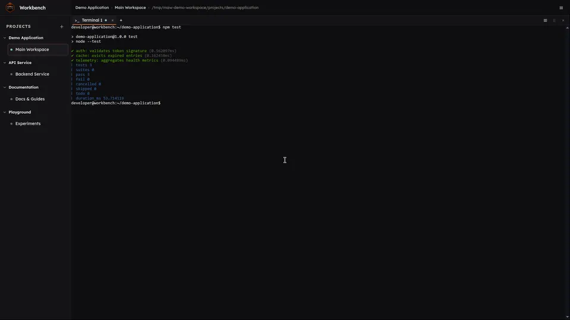

# Anvilary Workbench

**Local-first desktop workstation for AI coding agents, persistent terminals, native Chromium tabs, and multi-pane development workflows.** Organizes projects, supervised terminal sessions, installed coding CLIs, and isolated Chromium web views in a fluid Linux desktop interface.

An open-source product from [Anvilary Tools](https://anvilary.tools).

[](https://github.com/Anvilary/Workbench/actions/workflows/ci.yml)
[](LICENSE)
[](https://www.electronjs.org/)
[](https://react.dev/)

**English** · [Español](README.es.md) · [简体中文](README.zh-CN.md) · [日本語](README.ja.md) · [Português (Brasil)](README.pt-BR.md) · [Русский](README.ru.md) · [한국어](README.ko.md) · [Français](README.fr.md) · [Deutsch](README.de.md)

---

## Product Demonstration

Watch the complete **Project Organization -> Persistent Terminal -> Coding Agent -> Split Panes -> Native Chromium Web Tabs** workflow in action (high-definition desktop recording, 93 seconds):

[](https://github.com/Anvilary/Workbench/issues/32)

> 📹 **[Click here to watch the full HD demonstration video (MP4, 2.2 MB)](https://github.com/Anvilary/Workbench/issues/32)**

<details>
<summary><strong>Video Scene Breakdown & Demonstration Transcript</strong></summary>

1. **Scene 1: Initial Viewport & Single-Pane Workspace (0:00 - 0:08)**: Opening the clean dark desktop interface with canonical Anvilary orange identity accents, displaying the synthetic project tree in the sidebar and an uncluttered single full-width pane.
2. **Scene 2: Project Organization & Workspace Navigation (0:08 - 0:20)**: Navigating fluidly between multiple projects (Demo Application, Backend Service, and Docs & Guides) in the sidebar navigation tree.
3. **Scene 3: Supervised Persistent Terminal & Genuine Coding CLI (0:20 - 0:38)**: Launching a persistent terminal session, executing unit tests (`npm test` 3/3 passing), and verifying the installed Codex AI coding agent (`codex --version` and `codex --help`).
4. **Scene 4: Fluid Multi-Pane Split & Divider Resizing (0:38 - 0:50)**: Splitting the workspace vertically into balanced 50% / 50% columns, followed by interactive split divider dragging.
5. **Scene 5: Native Chromium Web Integration (0:50 - 1:04)**: Opening the Destination Picker, inspecting Favorites and Search Engines, and loading public technical documentation (`https://docs.anvilary.dev`) inside an isolated native Chromium view.
6. **Scene 6: Find in Page & Native Scroll Navigation (1:04 - 1:12)**: Invoking the in-page search bar (`Ctrl+F`), navigating live occurrences with keyboard navigation, and native view auto-scrolling.
7. **Scene 7: Application Settings & Resource Monitoring (1:12 - 1:25)**: Accessing the application shell menu and inspecting General, Terminal, Browser, Agents, and Usage/Monitoring telemetry.
8. **Scene 8: Final Balanced Workspace Composition & Outro (1:25 - 1:33)**: Returning to the balanced dual-pane layout displaying coding CLI output on the left and documentation on the right for a deliberate, visible 8-second closing composition.

*Note: All projects, directory paths, and terminal commands shown in the demonstration use synthetic fixtures and sanitized test data.*
</details>

---

## Why Workbench?

- **Persistent PTY Daemon**: Terminal sessions are supervised by an independent background daemon (`workbench-ptyd`). Long-running builds, autonomous coding agents, and test runners survive backend restarts and application updates without losing active processes or scrollback history.
- **Zero Credential Access**: Workbench runs the coding CLIs you already have installed and authenticated locally (such as `codex`, `claude`, `opencode`, or `agy`) inside standard terminals. It never intercepts, copies, or stores your API keys, passwords, or provider tokens.
- **Native Chromium Web Tabs**: Native Chromium `WebContentsView` instances embed documentation, web apps, and AI web interfaces directly inside workspace panes with isolated profiles, hardware acceleration, and native Find in Page.
- **Fluid Multi-Pane Split Layouts**: Split any workspace horizontally or vertically with interactive divider resizing, drag-and-drop tab and pane reordering, and independent pane focus synchronization.
- **Local-First Architecture**: Code, terminal history, browser profiles, and workspace layout state remain on your local machine. No cloud sync, no accounts, and no telemetry.

---

## Key Features

### Persistent Terminals and Coding CLIs
- **Clean Empty Workspace Start**: New workspaces open with an empty starting panel; no terminal launches automatically and no separate Coding Agent tab creator clutters the panel. Start any installed coding CLI (`claude`, `codex`, `opencode`, `agy`) or standard developer tool (`npm`, `cargo`, `git`) directly inside a terminal tab.
- **Supervised Processes**: The independent `workbench-ptyd` Unix-socket daemon supervises pseudo-terminals across backend restarts.
- **Scrollback and Search**: xterm.js terminal integration with scrollback persistence and incremental search.

### Native Chromium Web Tabs and Reliable Downloads
- **Isolated Browser Profiles**: Dedicated Electron session partitions (`persist:workbench-browser`, provider partitions, and custom workspace/project browser profiles) keep cookies and sessions isolated from Workbench internals.
- **Native Workspace Switching & Loading Identity**: Switching between projects and workspaces preserves active native Chromium views and displays the animated canonical Anvilary logo while pages load.
- **Destination Picker & Native Find in Page**: Quick access to developer favorites, search engines, arbitrary URLs, and Chromium-powered in-page search (`Ctrl+F`) with occurrence counters and smooth scrolling.
- **Native Save As & Remembered Destination**: Permitted browser downloads (including HTTPS attachments, provider delivery endpoints, validated redirects, and verified `blob:` exports) open the operating system's native Save As dialog by default. After a completed download, Workbench privately remembers the chosen destination directory across websites and application restarts, falling back safely to `Downloads` if a folder becomes unavailable. (`WORKBENCH_DOWNLOAD_AUTO_SAVE=1` is available strictly as an opt-in for headless automation.)

### Project, Workspace, and Pane Organization
- **Hierarchical Sidebar & Archive Recovery**: Organize multiple projects with isolated directories or Git worktrees, drag to reorder projects and workspaces, archive completed work, and restore archived projects and workspaces from the Archive recovery dialog.
- **Dynamic Split Layouts**: Split panes horizontally or vertically, drag split dividers smoothly, reorder tabs within panes, or drag tabs across panes.
- **Canonical Anvilary Identity**: Unified canonical Anvilary Tools branding across the desktop window, application icons, favicons, and browser loading states.

### Remote Access over SSH
Leave Workbench running on your host machine and reach it over a private SSH tunnel. The server remains bound strictly to loopback (`127.0.0.1`) with per-start authentication tokens and strict `Host`/`Origin` validation.

1. Enable OpenSSH on your host machine:

- **Linux (Debian / Ubuntu)**:
  ```bash
  sudo apt install openssh-server
  sudo systemctl enable --now ssh
  ```

- **Windows 10/11** (headless server host, PowerShell as administrator):
  ```powershell
  Add-WindowsCapability -Online -Name OpenSSH.Server~~~~0.0.1.0
  Start-Service sshd
  Set-Service -Name sshd -StartupType Automatic
  ```

2. Enable remote access in Workbench settings, pair your device, and connect through SSH port forwarding (`ssh -N -L 24837:127.0.0.1:24837 user@host`).

---

## Supported Platforms and Prerequisites

- **Desktop Workstation (Primary Target)**: **Linux (Ubuntu / Debian)** with X11 or Wayland desktop environment, systemd user sessions (for production service installation), **Node.js >= 22.12** (Node.js 22.13+ required for full local test and check suites), and **pnpm 12** (`corepack enable` uses the pinned `pnpm@12.21.0`).
- **Headless Web Server / CLI Package**: Runs on Node.js 20+ (validated in CI across Linux, macOS, and Windows for the headless server/CLI package only). Native Windows and macOS Electron desktop installers are not yet shipped.
- **AI Coding CLIs (Optional)**: Install your preferred CLIs (`claude`, `codex`, `opencode`, `agy`) on your `PATH`.

---

## Installation and Launch

### Option 1: Development Launch (Isolated Prototype, No Systemd Changes)

Use this workflow to build and run Workbench directly from a cloned checkout with isolated temporary state in `.native-chatgpt-local/`:

```bash
# Clone the repository
git clone https://github.com/Anvilary/Workbench.git
cd Workbench

# Install dependencies using the frozen lockfile
pnpm install --frozen-lockfile

# Build server and web production bundles
pnpm build

# Launch the isolated desktop prototype
pnpm desktop
```

### Option 2: Production Linux Installation (Supervised Systemd Services + Desktop Runtime)

For daily local workstation use on Ubuntu/Debian with persistent `workbench-ptyd.service` terminal supervision, atomic release staging, and desktop launcher integration:

For a legacy installation that already has data or services, use the [identity migration](docs/architecture/identity-migration.md) before installing the canonical services.

```bash
# 1. Install dependencies and build
pnpm install --frozen-lockfile
pnpm build

# 2. Install the launcher scripts, initial isolated release, and systemd user units
sh scripts/workbench/install.sh --service

# 3. Build and install the sandboxed Electron desktop runtime package (.deb) and desktop icons
sh scripts/workbench/install.sh --desktop

# 4. Start the supervised local service and launch Workbench desktop
anvi-bench start
anvi-bench desktop
```

`anvil-bench` and `maw` remain available as compatibility aliases of `anvi-bench`.

Routine updates stage into an isolated release directory without interrupting running terminals:

```bash
anvi-bench update --no-restart   # Stage the latest release
anvi-bench restart               # Activate safely while preserving workbench-ptyd.service
anvi-bench status                # Inspect service health and release pointers
```

---

## Local-First Architecture and Security

| Boundary Area | Isolation Mechanism | Verification Detail |
|---|---|---|
| **Local HTTP & WebSocket Server** | Loopback-only (`127.0.0.1`) with random per-start auth token | Authenticated mode is always the default; foreign `Origin` and non-loopback `Host` headers are rejected. |
| **Terminal Processes** | Independent `workbench-ptyd` Unix socket (`0700` dir, `0600` auth token) | Runs under your standard local user permissions; survives backend restarts without touching CLI credentials. |
| **Desktop & Browser Isolation** | Sandboxed Electron renderer + partitioned `WebContentsView` sessions | `sandbox: true`, `contextIsolation: true`, `nodeIntegration: false`; remote pages have zero privileged IPC. |
| **Downloads** | Scoped download policy + filename sanitization + native Save As | Validates URLs, redirects, and initiating `blob:` origins; prevents path traversal and silent overwrites. |
| **Session Metadata** | Atomic JSON storage in `~/.config/workbench` | Workspaces, layout trees, and tab states persist locally with `.bak` recovery and zero telemetry. |

See [SECURITY.md](SECURITY.md) for vulnerability reporting and security boundaries, and [PRIVACY.md](PRIVACY.md) for privacy details.

---

## Technology Stack

- **Desktop Shell**: [Electron 45.2.0](https://www.electronjs.org/) (`WebContentsView`, strict Chromium sandboxing)
- **Frontend UI**: [React 18.3](https://react.dev/), [TypeScript](https://www.typescriptlang.org/), custom CSS design tokens
- **Terminal Rendering**: [xterm.js](https://xtermjs.org/) with search and WebGL addons
- **Process Supervision**: Dedicated Unix-domain-socket daemon (`workbench-ptyd`) with `node-pty`
- **Layout Engine**: Binary split-tree reducer with `@dnd-kit` drag-and-drop orchestration
- **Build & Monorepo Tooling**: [pnpm workspaces](https://pnpm.io/workspaces), [Vite 6](https://vite.dev/), [esbuild](https://esbuild.github.io/)

---

## Local Development

```bash
# Typecheck all workspace packages
pnpm typecheck

# Run static, i18n, parser, and path-guard checks
env -u WORKBENCH_UNSAFE_LOCAL_NO_AUTH pnpm check

# Run unit tests across shared, desktop, server, and web packages
pnpm test:unit

# Build production server and web bundles
pnpm build
```

See [CONTRIBUTING.md](CONTRIBUTING.md) and [docs/operations/ci-and-release.md](docs/operations/ci-and-release.md) for integration, security, and Electron E2E test commands.

---

## Documentation Directory

- [Architecture v2 Specification](docs/architecture/architecture-v2.md): Modular design, dependency rules, and IPC contracts.
- [Browser Tabs](docs/browser/tabs.md): durable web tabs, `WebContentsView` ownership and URL policy.
- [Update and Rollback Guide](docs/operations/update-rollback.md): Atomic release staging, symlink promotion, and rollback safety.
- [CI and Release Runbook](docs/operations/ci-and-release.md): CI tiers, local release checklist, and operational invariants.
- [Security Policy](SECURITY.md): Security model, loopback auth defaults, and private vulnerability reporting.

The full list of documents is in the [documentation index](docs/README.md).

---

## Known Boundaries and Honest Limitations

- **Desktop Platform Support**: Native Electron desktop packaging and supervision currently target Linux (Ubuntu / Debian with X11 or Wayland). Native Windows and macOS desktop installers are not yet available.
- **Open File Tab Action**: The `Open File...` entry in the pane `+` tab menu is currently disabled and marked `Coming soon`.
- **Authenticated Third-Party Web Exports**: Native browser downloads (including Save As, remembered destinations, and Perplexity/GitHub `blob:` flows) are verified with deterministic synthetic fixtures; third-party site changes behind authenticated sessions may require future policy updates.
- **WebContentsView Z-Ordering**: Native Chromium views render in Electron's native compositor; HTML menus and modals coordinate surface visibility over active web views.
- **Daemon Socket Isolation**: `workbench-ptyd` relies on per-user Unix socket directory permissions (`0700`) under `$XDG_RUNTIME_DIR`.

---

## License and Attribution

Anvilary Workbench is open-source software distributed under the **[GNU Affero General Public License v3.0 or later (AGPL-3.0-or-later)](LICENSE)** for Anvilary-owned additions and modifications. Commercial and noncommercial use are permitted under the applicable license terms.

### Provenance and Upstream Attribution

Workbench builds upon **Agent Workbench**, originally released under the MIT License. The upstream code retains its MIT permissions and notices, preserved verbatim in [LICENSE.UPSTREAM](LICENSE.UPSTREAM).

- Upstream Agent Workbench: Copyright (c) 2026 Christian Velasquez, MIT licensed.
- Anvilary-specific extensions, Linux desktop shell, PTY supervisor, and multi-pane Chromium integration: Copyright (c) 2026 Alexandre Teixeira and applicable contributors.

The AGPL terms do not limit rights already granted for upstream MIT code. Historical revisions retain the licenses under which they were received. Third-party dependencies retain their respective licenses. See [LICENSING.md](LICENSING.md) for scope, corresponding-source obligations, and distribution guidance.
