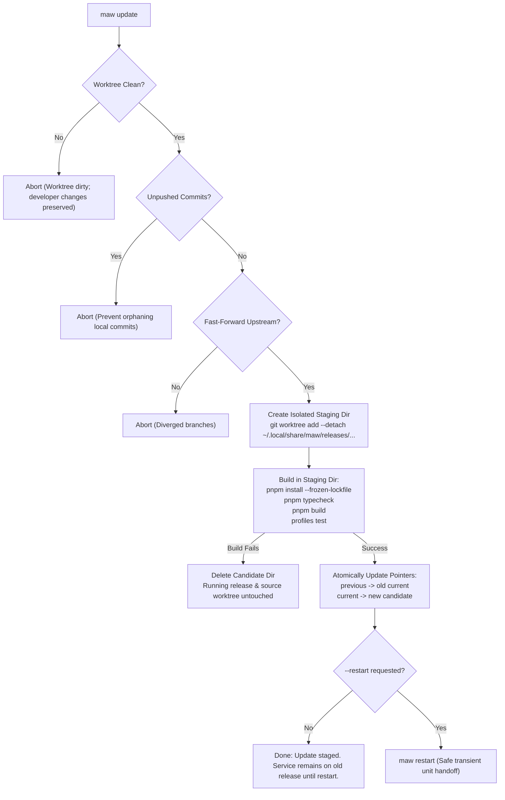

# MAW Launcher Guide (`maw`)

The `maw` launcher is the primary command-line interface for controlling, inspecting, browsing, and updating the My-Amazing-Workspace (MAW) systemd user service.

Installed binary: `/home/user/.local/bin/maw`  
Control helper: `/home/user/.local/lib/maw/control.mjs`  
Update engine: `/home/user/.local/lib/maw/maw-update.sh`  
Restart helper: `/home/user/.local/lib/maw/maw-restart-helper.sh`  
Active release pointer: `~/.local/share/maw/current` (symlink)  
Systemd unit: `maw.service` (managed as a systemd user service: `systemctl --user`)

---

## Subcommands Overview

All subcommands run from any working directory and operate against the user's systemd daemon.

```sh
maw {start|stop|restart|status|logs [--follow]|url|open [browser]|update [--no-restart|--restart]|help}
```

| Subcommand | Description | Safety / Side-Effects |
| --- | --- | --- |
| `maw start` | Starts `maw.service` via `systemctl --user start maw.service` | Idempotent; waits for systemd start. Never auto-opens a browser. |
| `maw stop` | Gracefully stops `maw.service` | Warns before stopping; server-owned live PTYs terminate; workspace metadata and native history remain intact. |
| `maw restart` | Restarts `maw.service` safely from outside or inside MAW | Warns that live PTYs terminate; delegates via transient user unit when invoked inside MAW; verifies readiness and auto-rolls back if replacement fails. |
| `maw status` | Displays systemd unit state, MainPID, and runs an authenticated loopback HTTP readiness probe | Token is never printed; queries `$XDG_RUNTIME_DIR/maw/maw-ready.json`. |
| `maw logs` | Displays the last 80 journal lines for `maw.service` without pager | Safe, read-only. Rate-limited by unit policy. |
| `maw logs --follow` | Follows live journal logs (`journalctl --user -u maw.service -n 80 --follow`) | Press `Ctrl+C` to exit. |
| `maw url` | Prints the authenticated localhost URL with token to `stdout` | **Local terminal only.** Never logged to journal or system logs. |
| `maw open [browser]` | Opens the authenticated web UI in the specified browser (or `xdg-open` by default) | Never opens automatically at service startup. Supports e.g. `maw open brave`. |
| `maw update` | Stages an update into an isolated candidate release directory | Never modifies the developer checkout; no destructive `git reset`; atomic pointer activation. |
| `maw help` | Prints the usage summary | Read-only. |

---

## Subcommand Details and Examples

### `maw start`
Starts the MAW service under `systemd --user`.
```sh
maw start
```
- Invokes `systemctl --user start maw.service`.
- Note: `maw start` does not automatically launch a browser. Use `maw open` or `maw url` to access the interface.

### `maw stop`
Terminates the running server process and its cgroup children.
```sh
maw stop
```
- Emits notice:
  ```text
  Server-owned live PTYs will terminate. Metadata and native history remain.
  ```
- Triggers `KillMode=control-group` teardown after allowing graceful store flush.

### `maw restart`
Restarts the MAW service safely from any shell, including from inside a MAW web terminal or CLI agent tab.
```sh
maw restart
```
- Emits notice:
  ```text
  Warning: Active server-owned live PTYs will terminate. Original PTY will not survive.
  Metadata and native history remain. Eligible verified native conversations use replacement PTYs during recovery.
  ```
- **Inside-MAW Protection**: Automatically detects when running inside the `maw.service` cgroup or process hierarchy.
  Instead of killing the calling shell synchronously, it schedules a detached transient systemd user timer unit (`maw-restart-<timestamp>`), avoids duplicate restart requests via lock file, reports scheduling status, and hands off the restart cleanly.
- **Readiness Verification**: Monitored by `maw-restart-helper.sh`, which verifies HTTP loopback readiness. If the new service fails to become healthy, it automatically rolls back `current` to `previous` and restarts the previous release.

### `maw status`
Checks both service-manager state and HTTP loopback readiness:
```sh
maw status
```
Example output:
```text
ActiveState=active
SubState=running
MainPID=4173951
ExecMainStatus=0
Healthy; PID 4173951; loopback port 34187
```

### `maw url`
Securely retrieves the authenticated loopback URL directly to `stdout`:
```sh
maw url
# Output:
# http://127.0.0.1:34187/?token=a1b2c3d4e5f6...
```
Conforms to strict loopback binding (127.0.0.1), file mode `0600`, directory mode `0700`, UID matching, and MainPID verification. Never recorded in systemd journals.

### `maw open [browser]`
Opens the authenticated session in the target browser:
```sh
# Open in Brave specifically:
maw open brave

# Open in system default browser:
maw open
```

---

## Verified Release-Staging (`maw update`)

The `maw update` command provides a safe, non-destructive update workflow for local checkouts:

```sh
# Stage update without restarting:
maw update --no-restart

# Stage update and restart immediately:
maw update --restart

# Update against specific ref:
maw update --ref origin/main
```

### Safety and Staging Pipeline



1. **Non-Destructive Staging**:
   - The developer's source repository is **never modified, merged into, or reset**.
   - Candidate releases are built in separate immutable directories (`~/.local/share/maw/releases/<timestamp>-<hash>`).
   - Even if concurrent modifications occur in the developer checkout during update staging, they survive untouched.
2. **Worktree Cleanliness & Upstream Verification**:
   - Checks `git status --porcelain` and `git log @{u}..HEAD`.
   - Native support for both `.git` directories and `.git` linked worktrees.
3. **Atomic Pointer Switch**:
   - On verification success, `~/.local/share/maw/previous` records the old release, and `~/.local/share/maw/current` is atomically updated via `mv -Tf`.
4. **Automatic Rollback**:
   - If the new release fails to achieve readiness on restart, `maw-restart-helper.sh` reverts `current` to `previous` and restores the healthy service.

---

## Developing MAW Inside MAW

Developing MAW from within MAW web terminals or CLI tabs is fully supported:

- **Safe Staging**: You can run `maw update --no-restart` while working in multiple CLI tabs. The active running server continues serving existing modules without disconnecting tabs or invalidating loaded assets.
- **Safe Restart**: When you are ready to activate the new version, running `maw restart` inside a MAW terminal schedules an independent transient unit outside the service control group:
  ```sh
  systemd-run --user \
    --unit="maw-restart-$(date +%s)" \
    --no-block \
    --description="MAW safe restart helper" \
    --on-active=1 \
    /bin/sh maw-restart-helper.sh --unit maw.service
  ```
- Active server-owned live PTYs terminate when the server restarts, and eligible native sessions resume with replacement PTYs upon reconnection.
