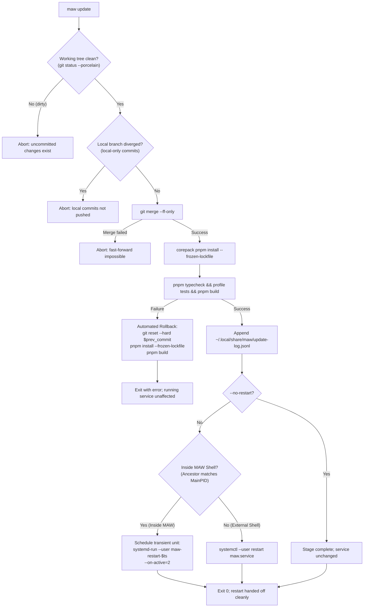

# MAW Launcher Guide (`maw`)

The `maw` launcher is the primary command-line interface for controlling, inspecting, browsing, and updating the My-Amazing-Workspace (MAW) systemd user service.

Installed binary: `/home/alteixeira20/.local/bin/maw`  
Control helper: `/home/alteixeira20/.local/lib/maw/control.mjs`  
Repository source: `scripts/maw/maw` and `scripts/maw/control.mjs`  
Systemd unit: `maw.service` (managed as a systemd user service: `systemctl --user`)

---

## Subcommands Overview

All subcommands run from any working directory and operate against the user's systemd daemon.

```sh
maw {start|stop|restart|status|logs [--follow]|url|open [browser]|update [--restart|--no-restart]|help}
```

| Subcommand | Description | Safety / Side-Effects |
| --- | --- | --- |
| `maw start` | Starts `maw.service` via `systemctl --user start maw.service` | Idempotent; waits for systemd start. |
| `maw stop` | Gracefully stops `maw.service` | Warns before stopping; server-owned live PTYs terminate; workspace metadata and native history remain intact. |
| `maw restart` | Restarts `maw.service` | Warns about terminating PTYs; eligible verified native conversations resume via replacement PTYs on next boot/startup. |
| `maw status` | Displays systemd unit state, MainPID, and runs an authenticated HTTP readiness probe | Token is never printed; queries `$XDG_RUNTIME_DIR/maw/maw-ready.json`. |
| `maw logs` | Displays the last 80 journal lines for `maw.service` without pager | Safe, read-only. Rate-limited by unit policy. |
| `maw logs --follow` | Follows live journal logs (`journalctl --user -u maw.service -n 80 --follow`) | Press `Ctrl+C` to exit. |
| `maw url` | Prints the authenticated localhost URL with token to `stdout` | **Local terminal only.** Never logged to journal or system logs. |
| `maw open [browser]` | Opens the authenticated web UI in the specified browser (or `xdg-open` by default) | Never opens automatically at service startup. |
| `maw update` | Safely updates the codebase, installs frozen dependencies, runs tests, and builds | Guards against dirty worktrees, diverged branches, and protects nested developer shells. |
| `maw help` | Prints the usage summary | Read-only. |

---

## Subcommand Details and Examples

### `maw start`
Starts the MAW service under `systemd --user`.
```sh
maw start
```
- Invokes `systemctl --user start maw.service`.
- Note: `maw start` does not automatically launch a browser. Use `maw open` or `maw url` to access the interface.

### `maw stop`
Terminates the running server process and its cgroup children.
```sh
maw stop
```
- Emits notice:
  ```text
  Server-owned live PTYs will terminate. Metadata and native history remain.
  ```
- Triggers `KillMode=control-group` teardown after allowing graceful store flush.
- Persists user stop intent (`stoppedByUser`) so agents are not unintentionally resumed on subsequent startup.

### `maw restart`
Restarts the MAW service.
```sh
maw restart
```
- Emits notice:
  ```text
  Server-owned live PTYs will terminate. Metadata and native history remain.
  Eligible verified native conversations use replacement PTYs during recovery.
  ```
- Active sessions with verified native context and attestation resume with replacement PTYs following the single-flight sequential recovery model.

### `maw status`
Checks both service-manager state and HTTP loopback readiness:
```sh
maw status
```
Example output:
```text
ActiveState=active
SubState=running
MainPID=4173951
ExecMainStatus=0
Healthy; PID 4173951; loopback port 34187
```
- If the service is stopped or unready, exits with code 1 and advice to check `maw logs`.

### `maw logs` and `maw logs --follow`
Inspects journalctl output filtered to `maw.service`:
```sh
# View recent 80 lines
maw logs

# Follow logs interactively
maw logs --follow
maw logs -f
```

---

## Security Model of `maw url`

The `maw url` command outputs the full loopback URL, including the cryptographic session authentication token:
```sh
maw url
# Output:
# http://127.0.0.1:34187/?token=a1b2c3d4e5f6...
```

### Confinement and Protections
1. **Stdout Only**: The token is written strictly to standard output for the invoking user. It is never emitted to systemd logs, journalctl, or shared logging pipelines.
2. **Strict Loopback Binding**: The URL is validated to ensure protocol `http:`, hostname `127.0.0.1`, a valid port, and that no credentials (`user:pass`) exist in authority.
3. **Restricted Runtime Metadata**: Token and port data are read from `$XDG_RUNTIME_DIR/maw/maw-ready.json`. This file is constrained to:
   - File mode `0600` (readable and writable only by the owner).
   - Parent directory `$XDG_RUNTIME_DIR/maw` mode `0700`.
   - File UID matches `process.getuid()`.
4. **PID Verification**: The PID reported in `maw-ready.json` is verified against `systemctl --user show maw.service --property=MainPID --value`. If the PIDs do not match, the file is rejected as stale.
5. **Local Authorized Use**: Useful for headless terminal sessions, remote SSH tunnels with local port forwarding, or pasting into specialized browsers without exposing the token to process tables or shell histories.

---

## Browser Launching with `maw open [browser]`

The `maw open` command opens the authenticated web application:
```sh
# Open using default system handler (xdg-open)
maw open

# Open using Brave browser specifically
maw open brave

# Open using Google Chrome
maw open google-chrome

# Open using Firefox
maw open firefox
```

### Behavior & Rules
- **No Auto-Launch on Service Start**: MAW never launches a browser tab unprompted when the systemd service starts or reboots.
- **Readiness Verification**: Before launching any browser, `maw open` performs an authenticated loopback HTTP check (`fetch(url)`). If MAW is not ready or unhealthy, the command fails and warns without spawning the browser.
- **Custom Browser Invocation**: When an argument (e.g., `brave`) is provided, `control.mjs` executes the binary with the authenticated URL passed as an argument directly, bypassing system default handler overrides.

---

## The `maw update` Workflow

`maw update` provides an atomic, verified, and safe mechanism for upgrading MAW in place.

```sh
# Update and stage changes without restarting (recommended when actively working)
maw update --no-restart

# Update and restart the service immediately
maw update --restart

# Default (runs update and applies default restart policy)
maw update
```

### Step-by-Step Update Execution & Safety Gates



1. **Worktree Cleanliness Check**:
   - Executes `git status --porcelain`.
   - Refuses to update if modified, unstaged, or untracked files are present in the repository, protecting working development states.
2. **Divergence Prevention**:
   - Compares the local branch head against the upstream tracking branch (`origin/<branch>`).
   - Refuses if local-only commits exist to avoid silent merge collisions or overwritten history.
3. **Fast-Forward Only Pull**:
   - Runs `git merge --ff-only`.
   - Guarantees a linear commit history; never generates merge conflict markers or unintended merge commits.
4. **Frozen Dependency Installation**:
   - Executes `corepack pnpm install --frozen-lockfile`.
   - Enforces deterministic dependencies pinned by `pnpm-lock.yaml`. Never updates dependencies loosely.
5. **Strict Build & Test Verification**:
   - Runs `pnpm typecheck`.
   - Runs focused profile and integration tests.
   - Runs `pnpm build` (producing clean client and server bundles).
6. **Update Log Recording**:
   - Logs timestamp, previous commit, target commit, command options, and exit status to:
     `~/.local/share/maw/update-log.jsonl`
7. **Automated Rollback on Verification Failure**:
   - If typecheck, tests, or build fail after `git merge --ff-only`, the update script executes:
     ```sh
     git reset --hard "$prev_commit"
     corepack pnpm install --frozen-lockfile
     corepack pnpm build
     ```
   - Restores the working tree and build artifacts to the exact pre-update state.
   - The running `maw.service` is never restarted or interrupted if build verification fails.

---

## Developing MAW inside MAW (Developer Protection)

MAW is frequently developed from within its own web-based workspace terminals and agent sessions. This introduces a recursive lifecycle challenge:

### The Problem: Ancestor Cgroup Teardown
- A developer runs `maw update --restart` inside a MAW terminal tab.
- The terminal shell process is a descendant of `maw.service` (MainPID).
- If the update script invokes `systemctl --user restart maw.service` directly:
  1. Systemd signals the entire control group of `maw.service` (`KillMode=control-group`).
  2. The shell running the update script is killed immediately.
  3. The update process is aborted mid-flight before writing audit logs, completing cleanup, or exiting cleanly.

### The Solution: Transient Systemd Unit Handoff
`maw update` detects whether its ancestor process tree belongs to `maw.service`:
1. It traverses ancestor process IDs (`PPID` chain) up to PID 1.
2. It fetches `MainPID` of `maw.service` via `systemctl --user show maw.service --property=MainPID --value`.
3. If any ancestor PID matches `MainPID`:
   - It **does not** call synchronous `systemctl --user restart`.
   - Instead, it launches an independent, out-of-cgroup transient timer unit:
     ```sh
     systemd-run --user \
       --unit="maw-restart-$(date +%s)" \
       --no-block \
       --on-active=2 \
       systemctl --user restart maw.service
     ```
   - The update process logs completion, writes `~/.local/share/maw/update-log.jsonl`, and exits with code 0.
   - Two seconds later (`--on-active=2`), systemd executes the restart asynchronously outside the dying cgroup.
   - MAW restarts cleanly, terminating the old session, and the user's browser reconnects to the refreshed server instance.

---

## End-to-End Acceptance Workflow

Follow this standard acceptance workflow to verify MAW and the launcher end-to-end:

1. **Start the Service**:
   ```sh
   maw start
   maw status
   ```
2. **Inspect and Verify Loopback URL**:
   ```sh
   maw url
   ```
   Confirm URL matches `http://127.0.0.1:<port>/?token=...`.
3. **Open in Target Browser**:
   ```sh
   maw open brave
   ```
   Confirm Brave launches directly without certificate warnings or token prompts.
4. **Create Project and Workspaces**:
   - In the web interface, click **Create Project**.
   - Create a workspace associated with `/home/alteixeira20/Projects/My-Amazing-Workspace`.
5. **Launch Tabs and Verify Operations**:
   - Open a Terminal tab.
   - Open a CLI Agent tab (e.g., Codex or AGY profile).
   - Open a Web tab.
6. **Perform In-Session Development**:
   - Work on feature files directly inside the MAW terminal or agent tab.
7. **Stage an Update Without Interrupting Work**:
   ```sh
   maw update --no-restart
   ```
   Confirm worktree cleanliness check passes, fast-forward pull completes, dependencies install, build succeeds, and the service remains active without disconnecting your tabs.
8. **Explicitly Activate the Update**:
   ```sh
   maw restart
   ```
   (Or from within MAW, run `maw update --restart`).  
   Confirm browser reconnects cleanly and workspace recovery resumes eligible sessions.
