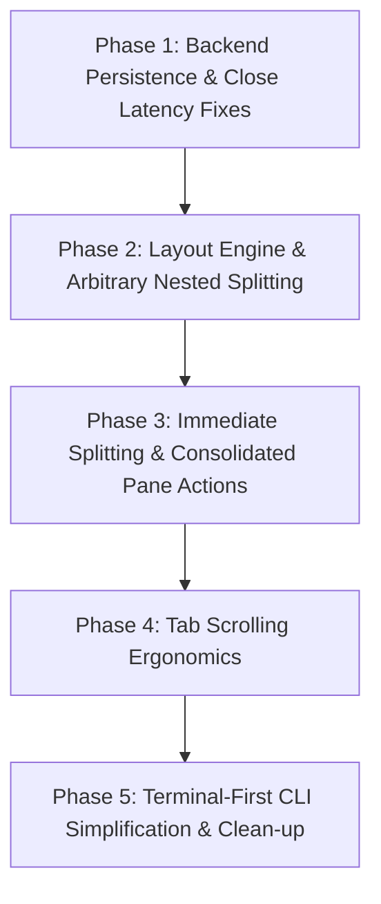

# MAW Stabilization Plan: Pane UX, Layout Persistence, and Terminal-First Workflow

Target Branch: `main`
Baseline Commit: `fe242b74796da604848e3e114e600f3a9d66d016`
Final Commit: `b56b4f3`
Status: Implemented and Verified

---

## 1. Verified Current Behavior

MAW Next-Generation has verified core persistent PTY capabilities:
- Independent systemd cgroups for backend and supervisor.
- Supervisor PID and shell PID survive backend restarts.
- Browser reconnects to existing terminals with continuous output and keyboard input.
- Cross-workspace isolation and atomic state persistence are operational.

However, users encounter several stabilization defects and workflow friction points during split-pane and terminal operations:
1. **Layout Save Failures**: Creating or manipulating split panes triggers an alert error: `"Could not save the layout: Error: Check the request settings and try again.: Layout tab does not belong to the requested workspace. Reconnect and try again."`
2. **Non-Immediate Splitting**: Clicking Split Right or Split Down opens a content-type selection menu (`PaneMenu`) instead of directly creating an adjacent terminal pane.
3. **Splitting Blocked at 4 Panes**: Panes (such as bottom-right in a 2x2 grid) cannot be split further due to a hardcoded `MAX_LEAVES = 4` limit.
4. **Hypersensitive Tab Scrolling**: Horizontal scrolling over pane tab strips captures touchpad gestures via `preventDefault`, ignores `deltaMode` scaling for mouse wheels, and jumps erratically.
5. **Pane Header Button Clutter**: Four distinct buttons (Split Right, Split Down, Maximize, Close) take up horizontal header space, crowding out tab titles.
6. **Delayed Terminal Closing**: Closing a terminal tab or pane blocks visually for up to 5 seconds while the backend polls synchronously for process termination.
7. **Fragmented CLI Workflows**: Dedicated CLI-launch UI (workspace mode selector, agent profile dropdowns, CLI launch modal dialog, composer) adds friction when the preferred workflow is launching CLIs directly from a normal terminal.

---

## 2. Defects and Severity Matrix

| Defect ID | Description | Severity | Impact |
|---|---|---|---|
| **DEF-01** | Layout persistence rejected with "Layout tab does not belong..." | High | Prevents users from saving split layouts; leaves error toasts visible; disrupts multi-pane workflows. |
| **DEF-02** | Splitting requires content-type picker interaction | Medium | High friction; interrupts terminal-first flow with unnecessary modal/menu decisions. |
| **DEF-03** | Arbitrary nested splitting blocked beyond 4 leaves | High | Prevents flexible multi-pane arrangements (e.g. 5 or 6 panes on ultrawide displays). |
| **DEF-04** | Horizontal tab scrolling is hypersensitive and jittery | Medium | Touchpads and mouse wheels jump tabs uncontrollably; poor ergonomics. |
| **DEF-05** | Pane header action buttons consume excessive space | Low | Tab titles truncate prematurely, reducing tab discoverability. |
| **DEF-06** | Closing terminal or pane delays visual removal by several seconds | High | Poor perceived performance; UI feels sluggish and unresponsive during process teardown. |
| **DEF-07** | Redundant CLI launch UI throughout Agency | Medium | Cognitive overhead; fragmented experience between dedicated launcher and in-terminal CLI usage. |

---

## 3. Confirmed Findings and Open Questions

### Confirmed Findings
1. **Server Layout Save Tab Omission (`DEF-01`)**:
   In `packages/server/src/terminal-socket.ts` line 3780, `openTabIds` includes `agencyRuntime.list` and `agencyBrowserTabs.listTabs`, but completely omits `agencyEditorTabs.listTabs`. Any workspace with an open editor tab fails layout validation.
2. **Mutation Concurrency Race (`DEF-01`)**:
   `agency.layout.save` does not run under `tabCoordinator.mutations.runExclusive(workspaceId)`. Concurrent tab creations or closures create race conditions between the client layout payload and server-side open tab sets.
3. **Debounced Save Timer Stale Closure (`DEF-01`)**:
   `AgencyWorkspaceView.tsx` uses a 200ms `saveTimer` capturing `nextLayout`. Tab removals during that window fire with stale tab references.
4. **Hardcoded Maximum Leaf Limit (`DEF-03`)**:
   `MAX_LEAVES = 4` is hardcoded in `split-layout.ts:15`, `SplitPaneTree.tsx:92`, and `AgencyWorkspaceView.tsx:461`. The binary tree replacement logic in `splitPane` is structurally sound and supports arbitrary depth; it was artificially capped at 4.
5. **Wheel Event Interception (`DEF-04`)**:
   `PaneHeader.tsx:157` calls `event.preventDefault()` on all wheel events regardless of `deltaX` vs `deltaY` and adds unscaled deltas directly to `scrollLeft`.
6. **Backend Process Teardown Blocking (`DEF-06`)**:
   `agency-session-runtime.ts:663-667` executes a 5-second synchronous polling loop `while (ACTIVE.has(...))` waiting for PTY shutdown before updating `closedAt` and sending the WebSocket acknowledgement.
7. **Orientation Conventions (`DEF-02`)**:
   In CSS flex and `SplitPaneTree.tsx`:
   - `direction: 'row'`: Vertical divider line, new pane on the right (user's "Split vertically creates a new pane to the right").
   - `direction: 'column'`: Horizontal divider line, new pane below (user's "Split horizontally creates a new pane below").

### Open Questions and Architectural Trade-Offs
1. **Maximum Pane Ceiling vs Geometry Constraints**:
   While `MAX_LEAVES = 4` was too restrictive, unlimited panes can degrade performance, overwhelm WebContentsView positioning in Electron, and shrink terminals below minimum readable dimensions.
   *Resolution*: Increase `MAX_LEAVES` to 8 (or 12), combined with an interactive minimum DOM size check (reject split if pane width < 240px or height < 150px).
2. **Manual CLI Notifications Contract**:
   Can manually launched CLIs (e.g. running `claude` or `codex` inside bash) emit per-turn activity completion events without dedicated session hooks?
   *Resolution*: Shell integration (OSC 133) accurately detects command start and command exit, but intermediate conversational turns inside an interactive CLI process require CLI-level hooks. We document this boundary honestly and do not claim false parity.

---

## 4. Target Interaction Contracts

### Contract 1: Layout Persistence and Ownership
- `evaluateLayoutSave` remains a strict security and isolation boundary. It accepts layouts where every tab in the layout tree belongs to the workspace and is currently open.
- Server validates `openTabIds` constructed from:
  1. Live native sessions (`agencyRuntime.list(ws).filter(s => s.tab?.current && !s.tab.closedAt)`)
  2. Open browser tabs (`agencyBrowserTabs.listTabs(ws)`)
  3. Open editor tabs (`agencyEditorTabs.listTabs(ws)`)
- `agency.layout.save` executes under `tabCoordinator.mutations.runExclusive(workspaceId)`.
- Client-side `save(layout)` automatically reconciles `layout` against currently active `openTabIds` before sending to the server.
- Debounced save timers are cancelled immediately when a tab is closing or removed.

### Contract 2: Immediate Splitting
- Clicking "Split vertically" immediately creates a new pane to the right containing a new default terminal.
- Clicking "Split horizontally" immediately creates a new pane below containing a new default terminal.
- No content picker or modal dialog is shown.
- Keyboard focus shifts immediately to the newly created terminal pane.
- If the terminal creation request fails, `rollbackPane` reverts the layout to the exact prior tree, leaving no orphan terminal or empty pane.

### Contract 3: Arbitrary Nested Splitting
- Any pane in the layout tree can be split in either direction up to `MAX_LEAVES = 8`.
- Splitting is allowed on root panes, nested row panes, and nested column panes.
- If a pane is smaller than 240px width (for vertical split) or 150px height (for horizontal split), the split action is disabled with an explanatory tooltip (`"Pane too small to split"`).

### Contract 4: Tab Scrolling Ergonomics
- Touchpad horizontal swipes (`Math.abs(deltaX) > Math.abs(deltaY)`): Native browser scrolling is untouched (`preventDefault` is NOT called). Touchpad momentum and rubber-banding function naturally.
- Vertical mouse wheels over tab strip: Scaled by `deltaMode` (1 line = ~18px, pixel deltas dampened to ~40px per notch).
- Scroll boundary bubbling: When the tab strip is at its scroll limit, vertical wheel events bubble to allow normal page/pane scrolling.
- Accessibility: Respects `prefers-reduced-motion` for programmatic scroll adjustments.

### Contract 5: Consolidated Pane Action Menu
- Pane header action buttons are consolidated into one button with the standard 3-line menu icon (`<path d="M2.75 4.5h10.5M2.75 8h10.5M2.75 11.5h10.5" />`).
- The button opens a portal-anchored `PaneMenu` containing:
  1. `Split vertically` (creates new pane to the right with terminal)
  2. `Split horizontally` (creates new pane below with terminal)
  3. `Maximize pane` / `Restore pane` (toggle)
  4. `Close pane` (disabled if only 1 pane exists)
- The drag grip (`PaneGrip`) is positioned directly adjacent to the menu button.
- Reclaims approximately 100px of header width for tab titles.

### Contract 6: Instant Visual Terminal Closure
- When a user confirms closing a terminal:
  1. The confirmation modal dismisses immediately.
  2. The tab is added to a local optimistic `closingTabIds` set.
  3. The tab is removed from the visible layout immediately; adjacent fallback tab is focused.
  4. The WebSocket close request is dispatched in the background.
- On the server:
  1. `tab.closedAt` is set to `NOW()` immediately in durable state.
  2. The close request is acknowledged immediately.
  3. Process stop (`this.stop(sessionId)`) and supervisor cleanup continue asynchronously in the background.
- If the server rejects the close request, the client rolls back the optimistic removal, restores the tab, and displays an error message.

### Contract 7: Terminal-First CLI Workflow
- New workspace creation dialog presents Project selection, Workspace Name, and Folder Picker. Redundant "Workspace Type" (agent/terminal/combined/empty) and CLI profile dropdowns are removed.
- Newly created workspaces launch with a standard terminal in the selected directory.
- Users launch CLIs (`codex`, `claude`, `agy`, `opencode`) directly inside the terminal.
- Backend CLI adapters, configuration storage, and session records are preserved for session recovery and binary discovery, but frontend launch wrappers are eliminated.

---

## 5. Source Files Involved

### Shared Package (`packages/shared/`)
- `src/split-layout.ts`:
  * Increase `MAX_LEAVES` to 8 (or 12).
  * Update `splitPane` defaults and verify leaf count validation across operations.
  * Ensure `reconcileLayout` and `layoutOwnershipError` handle editor tabs and higher leaf counts cleanly.

### Server Package (`packages/server/`)
- `src/terminal-socket.ts`:
  * In `agency.layout.save` handler (line 3780): add `agencyEditorTabs.listTabs(message.workspaceId).map(t => t.id)` into `openTabIds`.
  * Wrap `agency.layout.save` inside `tabCoordinator.mutations.runExclusive(message.workspaceId, ...)`.
- `src/agency/agency-session-runtime.ts`:
  * In `tabAction(..., 'close')`: record `tab.closedAt = NOW()`, persist session state, and dispatch asynchronous `this.stop(source.id)` without blocking the response in a 5-second polling loop.
- `src/agency/split-layout.test.ts`:
  * Update leaf count tests and add nested split regression cases.

### Web Package (`packages/web/`)
- `src/agency/AgencyWorkspaceView.tsx`:
  * Direct terminal split creation in `onSplitCreate`.
  * Optimistic tab closure handling with rollback support.
  * Reconcile layout against active `openTabIds` prior to sending `agency.layout.save`.
  * Remove CLI picker modal dialog, model/effort selectors, and "Start again" wrapper.
- `src/agency/split/PaneHeader.tsx`:
  * Consolidate 4 action buttons into single 3-line menu dropdown (`PaneMenu`).
  * Update wheel event listener for natural touchpad deltaX and normalized deltaY.
  * Remove "New CLI" and individual agent profile items from `+` Add Tab menu.
- `src/agency/split/SplitPaneTree.tsx`:
  * Update `canSplit` limit to match `MAX_LEAVES = 8` and add pane geometry check.
- `src/agency/AgencyWorkspaceCreator.tsx`:
  * Remove workspace mode selector and CLI profile dropdown; default to standard terminal workspace.
- `src/agency/AgencyApp.tsx`:
  * Simplify `onCreate` workspace handler to spawn a standard terminal.
- `src/agency/AgencyComposer.tsx`:
  * Remove deprecated file.
- `src/i18n/locales/*.json` (all 9 locale files):
  * Update strings for consolidated pane menu items (`Split vertically`, `Split horizontally`, etc.).

---

## 6. Implementation Sequence

The implementation is structured into five isolated phases. Each phase is independently testable and verifiable.

### Phase 1: Backend Persistence and Close Latency Fixes
1. Include `agencyEditorTabs` in `openTabIds` inside `packages/server/src/terminal-socket.ts`.
2. Wrap `agency.layout.save` in `tabCoordinator.mutations.runExclusive`.
3. In `agency-session-runtime.ts`, decouple process termination from tab close acknowledgement: commit `closedAt` immediately and stop process asynchronously.
4. Add server unit tests in `split-layout.test.ts` verifying editor tab preservation and concurrent layout save safety.

### Phase 2: Layout Engine and Arbitrary Nested Splitting
1. In `packages/shared/src/split-layout.ts`, raise `MAX_LEAVES` to 8.
2. In `packages/web/src/agency/split/SplitPaneTree.tsx`, update `canSplit` calculation and add minimum pane geometry check (width >= 240px, height >= 150px).
3. In `packages/web/src/agency/AgencyWorkspaceView.tsx`, update leaf count checks.
4. Add unit tests for 5-pane, 6-pane, and 8-pane nested splits (including splitting the bottom-right quadrant of a 2x2 grid).

### Phase 3: Immediate Splitting and Consolidated Pane Actions
1. In `PaneHeader.tsx`, consolidate Split Right, Split Down, Maximize, and Close buttons into a single 3-line action menu dropdown.
2. Wire "Split vertically" and "Split horizontally" menu items to invoke `onSplitCreate(direction, 'terminal')` directly.
3. Remove content-type picker dialog interception.
4. In `AgencyWorkspaceView.tsx`, implement optimistic tab closing with rollback on rejection.

### Phase 4: Tab Scrolling Ergonomics
1. In `PaneHeader.tsx`, rewrite `onWheel` listener:
   - Check if horizontal delta dominates; if so, pass through to native browser scroll engine without calling `preventDefault()`.
   - If vertical wheel is used, normalize by `deltaMode` and scroll tab strip smoothly.
   - If scroll reaches boundaries, allow event to bubble.
   - Respect `window.matchMedia('(prefers-reduced-motion: reduce)')`.

### Phase 5: Terminal-First CLI Simplification and Clean-Up
1. In `AgencyWorkspaceCreator.tsx`, remove workspace mode dropdown and CLI profile selector.
2. In `AgencyApp.tsx`, simplify workspace creation handler to spawn a normal terminal.
3. In `PaneHeader.tsx`, remove "New CLI" and individual agent profiles from the `+` Add Tab menu.
4. In `AgencyWorkspaceView.tsx`, remove the CLI picker dialog and unused profile state.
5. Delete deprecated `AgencyComposer.tsx`.
6. Update localization keys across all 9 language files.

---

## 7. Regression and Visual Acceptance Plan

### 7.1 Automated Unit and Integration Tests
- **Split Layout Invariants**:
  * Single-pane default creation.
  * Splitting vertically (row) and horizontally (column).
  * Repeated nested splitting up to 8 panes (including bottom-right pane in 2x2 grid).
  * Pane closure merging tabs to remaining pane.
  * Tab movement between arbitrary nested panes.
  * Clamping split ratios between 0.1 and 0.9.
- **Server Persistence Validation**:
  * Layout save containing native terminal tabs, ChatGPT browser tabs, and editor tabs.
  * Concurrency stress test: in-flight tab creation during layout save.
  * In-flight tab closure during layout save.
  * Reconnection snapshot replay preserving reconciled layouts.
- **Optimistic Close Lifecycle**:
  * Instant visual removal of running terminal tab upon user confirmation.
  * Asynchronous PTY process shutdown without blocking WebSocket response.
  * Rollback test: simulated server rejection restores tab and displays error toast.

### 7.2 Browser and Desktop Acceptance Tests
- **Headless Chromium / Playwright**:
  * Exercise split right, split down, and verify DOM node creation without picker menus.
  * Exercise 8-pane grid creation and check pane boundary rects.
  * Test tab strip wheel scrolling with simulated mouse wheel and touchpad events.
  * Verify consolidated pane menu keyboard navigation (ArrowUp, ArrowDown, Escape, Enter).
- **Electron Desktop Mode**:
  * Verify `mawChatGpt` native `WebContentsView` bounds alignment across 4-pane and 8-pane layouts.
  * Verify drag shield prevents native WebContentsView from obscuring dragged tab ghosts.
  * Verify PTY PID survival across backend restart while split layouts are active.

---

## 8. Runtime Compatibility and Safety Considerations

1. **PTY Process Invariant Preservation**:
   All changes operate at the UI layout and session coordinator level. Backend PTY supervisor cgroups, shell PIDs, and terminal websocket streams are untouched.
2. **Saved State Migration**:
   Existing `agency-state.json` and `agency-layouts.json` files remain 100% compatible. Layouts saved with version 1 continue to load and reconcile cleanly.
3. **Rollback Safety**:
   If an optimistic tab close is rejected by the server, the tab is restored immediately to its pane without losing output history or connection state.
4. **Authority Boundary Integrity**:
   `evaluateLayoutSave` is NOT weakened. It continues to verify that every tab in a layout belongs to the specified workspace and is open. The fix resolves the bug where valid editor tabs were omitted from the server's open tab set.

---

## 9. Recommended Deletion vs Retention of Redundant Agent UI

| Component / Subsystem | Recommendation | Justification |
|---|---|---|
| `AgencyComposer.tsx` | **Delete** | Unused legacy file; already disconnected from the workspace view. |
| `AgencyWorkspaceCreator` Mode Dropdown | **Remove** | Users want to enter a workspace and get a terminal; mode picker creates unnecessary friction. |
| `AgencyWorkspaceCreator` Profile Dropdown | **Remove** | Profile selection at workspace creation is redundant when CLIs run directly in terminals. |
| `AgencyWorkspaceView` CLI Picker Dialog | **Remove** | Dedicated "Start CLI" dialog is superseded by launching CLIs in the terminal. |
| `PaneHeader` "New CLI" Menu Items | **Remove** | "New Terminal", "New ChatGPT Tab", "New GitHub Tab", and "Open File" cover all user needs. |
| Backend CLI Adapters (`codex`, `claude`, etc.) | **Retain** | Required for session history parsing, conversation recovery, and binary discovery. |
| `TabActivityManager` & Shell Integration | **Retain** | Essential for detecting terminal command start and finish via OSC 133 sequences. |
| Saved Profiles in `agency-state.json` | **Retain** | Preserves user preferences and environment configurations without data loss. |

---

## 10. Summary and Implementation Outcome

All five implementation phases have been completed and verified against the production test suites and browser acceptance harnesses:

1. **Phase 1 (Layout Persistence & Concurrency)**: Implemented in commit `4cc84ae`.
2. **Phase 2 (Recoverable Terminal Close)**: Implemented in commit `2ce5b18`.
3. **Phase 3 (Arbitrary Nested Splitting)**: Implemented in commit `9b29033`.
4. **Phase 4 (Immediate Splitting, Minimal Menu & Tab Scrolling)**: Implemented in commit `af96446`.
5. **Phase 5 (Terminal-First CLI Simplification)**: Implemented in commit `45649b7`.
6. **Store Timer Reference**: Implemented in commit `b56b4f3`.

All unit tests, integration tests, browser acceptance tests, typechecking, and production builds pass cleanly.

---

## 11. Final Acceptance Audit Remediation

An independent acceptance review of commit `b56b4f3` verified system invariants and identified four non-blocking findings. Each finding was remediated with focused, surgical commits on `main`:

### 11.1 Finding 1 (P2): Terminal Close Concurrency & Lock Decoupling
- **Root Cause**: [`AgencySessionRuntime`](file:///home/user/Projects/My-Amazing-Workspace/packages/server/src/agency/agency-session-runtime.ts) held the synchronous 5-second process shutdown polling loop under the workspace mutation lock in [`AgencyTabCoordinator`](file:///home/user/Projects/My-Amazing-Workspace/packages/server/src/agency/tab-coordinator.ts), blocking unrelated concurrent tab operations and layout saves.
- **Resolution**: Implemented two-phase close concurrency. Phase 1 performs validation and selection fallback under the workspace mutation lock. Phase 2 awaits supervisor process exit outside the workspace lock with deduplicated in-flight tracking. Phase 3 executes final state cleanup under the lock. Authoritative termination remains required before acknowledgement, and failure rollback restores managed state if termination times out.
- **Commit**: `5747503` (`fix(agency): implement non-blocking two-phase terminal close concurrency`).

### 11.2 Finding 2 (P3): Remove Remaining Legacy CLI Launcher UI
- **Root Cause**: Dead modal dialog branches (`newCLI`), picker state, and unused callback props (`onAddCliClick`, `onLaunchProfile`) remained in [`AgencyWorkspaceView.tsx`](file:///home/user/Projects/My-Amazing-Workspace/packages/web/src/agency/AgencyWorkspaceView.tsx), [`SplitPaneTree.tsx`](file:///home/user/Projects/My-Amazing-Workspace/packages/web/src/agency/split/SplitPaneTree.tsx), and [`PaneHeader.tsx`](file:///home/user/Projects/My-Amazing-Workspace/packages/web/src/agency/split/PaneHeader.tsx).
- **Resolution**: Removed the unused CLI picker modal branch, `picker` state, and dead callback props. Retained only active modal dialogs (`closing`, `webDialog`, `fileDialog`) and preserved session profile configuration dialog for existing sessions, backend adapters, and terminal-first workflows.
- **Commit**: `a0aa22f` (`refactor(web): remove obsolete agent CLI launch dialog and state from workspace view`).

### 11.3 Finding 3 (P3): Release Staging Test Portability
- **Root Cause**: Test 13 in [`release-staging.test.sh`](file:///home/user/Projects/My-Amazing-Workspace/scripts/maw/release-staging.test.sh) assumed `/usr/bin/corepack` fails on pnpm 12, failing on modern systems where Corepack succeeds with pnpm 12.
- **Resolution**: Created an isolated deterministic fixture that reproduces the historical Corepack 0.24 failure mode (`Cannot find module '.../pnpm.cjs'`) if the host Corepack does not exhibit the legacy bug.
- **Commit**: `5698640` (`test(staging): make corepack reproduction test deterministic with isolated fixture`).

### 11.4 Finding 4 (P3): Web Test Runner TypeScript Compatibility
- **Root Cause**: Standard `node --test` failed with `ERR_UNKNOWN_FILE_EXTENSION` when tests imported `.ts` files directly in [`packages/web/package.json`](file:///home/user/Projects/My-Amazing-Workspace/packages/web/package.json).
- **Resolution**: Configured the web test script to use `tsx --test`, matching the convention in `@agent-workbench/server`.
- **Commit**: `045bc4b` (`fix(web): configure test runner with tsx for TypeScript ESM compatibility`).
