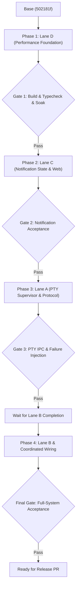

# Deterministic Integration Sequence

**Target Branch:** `integration/maw-next-generation`  
**Base Commit:** `502181f235ce8d0f9f9c83661c874bc7cde014e1`  
**Date:** 2026-11-03  
**Status:** Planned Multi-Phase Integration Pipeline

---

## 1. Overview and Preconditions

To eliminate risk and guarantee deterministic reproducibility, the integration of the four Next-Generation lanes is structured into **Four Sequential Phases**. 

### Hard Preconditions Before Phase 1:
1. `git status --porcelain` is empty in `MAW-next-gen-integration`.
2. Verified lane HEAD revisions:
   - Lane A: `0311ae10f39bba39a7eb5c186c0239012cf314b0`
   - Lane C: `2147c90`
   - Lane D: `7d85b1a`
   - Lane B: Target commit hash published upon completion (clean working tree).
3. Baseline test suite passes on base `502181f` (`pnpm typecheck`, `pnpm build`, `pnpm test`).
4. Blocking defects A-002 and C-002 must have verified patch fixes applied during their respective phases.

---

## 2. Phase-by-Phase Integration Pipeline



---

## 3. Phase 1: Lane D Integration (Performance Infrastructure)

**Rationale:** Lane D introduces pure helper modules (`classic-workbench-lifecycle.ts`, `terminal-output-batcher.ts`, `coalesced-json-store.ts`) and build tooling without modifying existing production modules. Integrating Lane D first establishes the performance and persistence foundation required by subsequent lanes.

### Step 1.1: Import Commits from Lane D
Cherry-pick commits from `feat/maw-performance` (commit `7d85b1a`):
- `packages/server/src/classic-workbench-lifecycle.ts`
- `packages/server/src/classic-workbench-lifecycle.test.ts`
- `packages/server/src/terminal-output-batcher.ts`
- `packages/server/src/terminal-output-batcher.test.ts`
- `packages/server/src/coalesced-json-store.ts`
- `packages/server/src/coalesced-json-store.test.ts`
- `packages/server/scripts/build-bundle.mjs`
- `packages/server/src/build-bundle.test.ts`
- Documentation and benchmarks under `docs/research/maw-next-generation/lanes/D/`

### Step 1.2: Apply Patch Fixes for Non-Blocking Findings
1. **Fix D-001:** Harden `ClassicWorkbenchLifecycle.dispose()` to await in-flight `startPromise`.
2. **Fix D-002:** Add `"pretest": "node scripts/build-bundle.mjs"` to `packages/server/package.json` to ensure bundle exists before `build-bundle.test.ts` runs.

### Step 1.3: Verification Gate 1
```bash
pnpm --filter @agent-workbench/server build
pnpm --filter @agent-workbench/server exec tsx --test src/classic-workbench-lifecycle.test.ts
pnpm --filter @agent-workbench/server exec tsx --test src/terminal-output-batcher.test.ts
pnpm --filter @agent-workbench/server exec tsx --test src/coalesced-json-store.test.ts
node packages/server/scripts/build-bundle.mjs
pnpm --filter @agent-workbench/server exec tsx --test src/build-bundle.test.ts
```
**Rollback Trigger:** If any test fails or `dist/index.mjs` fails to execute `--prod`, revert commit.

---

## 4. Phase 2: Lane C Integration (Notification Engine & Focus Tracking)

**Rationale:** Lane C modifies `AgencyNotificationStore`, `TabActivityManager`, and web UI components. Integrating Lane C next tests notification persistence and web build cleanliness before PTY supervisor IPC is introduced.

### Step 2.1: Import Commits from Lane C
Cherry-pick commits from `feat/maw-notifications` (`784bc2e`, `5ea01b2`, `01552b1`, `2147c90`):
- `packages/server/src/agency/agency-notification-store.ts`
- `packages/server/src/agency/tab-activity-manager.ts`
- `packages/server/src/agency/notification-acceptance-suite.test.ts`
- `packages/web/src/agency/**`
- `packages/web/package.json`
- Documentation under `docs/research/maw-next-generation/lanes/C/`

### Step 2.2: Apply Remediation for Confirmed Defect C-002
In `packages/server/src/agency/agency-notification-store.ts`:
Add deduplication index eviction during inbox pruning:
```typescript
if (this.notifications.size > MAX_NOTIFICATIONS) {
  const candidates = [...this.notifications.values()]
    .filter((n) => n.read && n.acknowledgedAt && n.id !== id)
    .sort((a, b) => Date.parse(a.createdAt) - Date.parse(b.createdAt));
  const excess = this.notifications.size - MAX_NOTIFICATIONS;
  for (let i = 0; i < Math.min(excess, candidates.length); i++) {
    const victim = candidates[i];
    if (victim) {
      this.notifications.delete(victim.id);
      if (victim.deduplicationKey) {
        this.deduplicationIndex.delete(victim.deduplicationKey);
      }
    }
  }
}
```

### Step 2.3: Verification Gate 2
```bash
pnpm --filter @agent-workbench/server exec tsx --test src/agency/notification-acceptance-suite.test.ts
pnpm --filter @agent-workbench/web exec node --test src/agency/notifications.test.mjs
pnpm --filter @agent-workbench/server exec tsx --test ../web/src/agency/focus-tracker.test.ts
pnpm typecheck
pnpm build
```
**Rollback Trigger:** Typecheck failure or test regression reverts to Phase 1 HEAD.

---

## 5. Phase 3: Lane A Integration (Persistent PTY Supervisor)

**Rationale:** Lane A brings the standalone daemon `maw-ptyd.mjs`, protocol definitions, and client adapter. It does not touch server entrypoints yet, keeping integration risk zero until Lane B connects them.

### Step 3.1: Import Commits from Lane A
Cherry-pick commits from `feat/maw-pty-supervisor` (`edff545`, `eea16c0`, `35d53d3`, `0311ae1`):
- `packages/server/src/output-buffer.ts` and test
- `packages/server/src/pty-host/**`
- `scripts/maw/pty-host/**`
- Documentation under `docs/research/maw-next-generation/lanes/A/`

### Step 3.2: Apply Remediation for Confirmed Defect A-002
In `scripts/maw/pty-host/maw-ptyd.service`:
Change `KillMode=control-group` to `KillMode=process`:
```ini
KillMode=process
KillSignal=SIGTERM
FinalKillSignal=SIGKILL
```

### Step 3.3: Verification Gate 3
```bash
pnpm --filter @agent-workbench/server exec tsx --test src/output-buffer.test.ts
pnpm --filter @agent-workbench/server exec tsx --test src/pty-host/persistent-pty-acceptance.test.ts
pnpm --filter @agent-workbench/server exec tsx --test src/pty-host/failure-injection.test.ts
```
**Rollback Trigger:** IPC failure, socket permission defect, or unhandled rejection reverts to Phase 2 HEAD.

---

## 6. Phase 4: Lane B Integration & Coordinated Entrypoint Wiring

**Precondition:** Lane B finishes active implementation, passes internal verification, and publishes its final commit hash.

### Step 4.1: Import Commits from Lane B
Merge or cherry-pick Lane B changes:
- `packages/server/src/terminal-registry.ts` (pty-host adapter)
- `packages/desktop/main.mjs` (readiness polling & focus events)
- `packages/web/src/TerminalView.tsx` (monotonic reattach)
- Reconnection acceptance tests

### Step 4.2: Coordinated Wiring of Shared Entrypoints
1. **`packages/server/src/index.ts`:**
   - Integrate `ClassicWorkbenchLifecycle` (Lane D).
   - Hook `registry.detachAll()` to `shutdown()` handler (Lane B/A).
   - Wire `MAW_PERSISTENT_PTY` feature flag.
2. **`packages/server/src/terminal-socket.ts`:**
   - Attach `TerminalOutputBatcher` (Lane D).
   - Wire `sinceOffset` replay requests (Lane B/A).
   - Call `classicLifecycle.ensureStarted()` on classic route access (Lane D).
3. **`packages/server/scripts/build-bundle.mjs`:**
   - Add copy step to ensure `maw-ptyd.mjs` is placed in `packages/server/dist/` so the standalone bundle can spawn the supervisor.

### Step 4.3: Final Verification Gate (Full-System Acceptance)
Execute full acceptance harness:
```bash
pnpm typecheck
pnpm build
pnpm test
# Run isolated full-system acceptance test suite
pnpm --filter @agent-workbench/server exec tsx --test docs/research/maw-next-generation/integration/tests/full-system-acceptance.test.ts
```

---

## 7. Rollback Strategy & Failure Recovery

| Failure Scenario | Recovery Action | Verification Command |
|---|---|---|
| Phase 1 fails (Performance regressions or bundle errors) | Revert cherry-picks to base `502181f` | `git reset --hard 502181f` |
| Phase 2 fails (Notification type errors or test failure) | Revert to Phase 1 HEAD | `git reset --hard <phase-1-commit>` |
| Phase 3 fails (PTY socket or IPC failure) | Revert to Phase 2 HEAD | `git reset --hard <phase-2-commit>` |
| Phase 4 fails (Wiring conflict or process survival failure) | Revert shared file edits; isolate Lane B | Revert only Phase 4 commits |
| Production smoke failure | Set `MAW_PERSISTENT_PTY=0`, `MAW_EAGER_CLASSIC=1` | Instant runtime mitigation via env vars |
